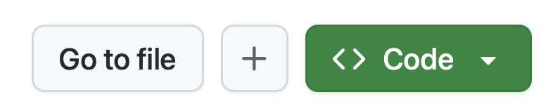

Copilot cloud agent の演習を始める前に、必要な準備を整えます。Tailspin Toys リポジトリの自分用コピーを作成し、[codespace][codespaces] を立ち上げます。codespace は、指示ファイルの編集や cloud agent が作成した作業のレビューに使います。

## ラボ用リポジトリを設定する

作成するコード用のコピーを作るため、[template][template-repository] から新しいリポジトリを作成します。新しいリポジトリにはラボに必要なすべてのファイルが含まれており、演習中はこのリポジトリを使います。

1. 新しいブラウザー ウィンドウで [Tailspin Toys template][tailspin-template] に移動します。
2. ラボ用リポジトリのページで **Use this template** ボタンを選び、自分用のコピーを作成します。次に **Create a new repository** を選びます。

    

3. GitHub または Microsoft が主催するイベントの一環として参加している場合は、メンターの案内に従ってください。それ以外の場合は、GitHub Copilot を利用できる organization に新しいリポジトリを作成します。

    

4. ラボの後半で使うため、作成したリポジトリのパス (**organization-or-user-name/repository-name**) を控えておきます。

## Codespace を作成する

次は、codespace を使って演習を進めます。

[GitHub Codespaces][codespaces] はクラウドベースの開発環境です。ブラウザーから直接コードを作成、実行、デバッグできます。複数のプログラミング言語、拡張機能、ツールをサポートするフル機能の IDE を利用できます。

1. 新しく作成したリポジトリに移動します。
2. 緑色の **Code** ボタンを選びます。

    

3. **Codespaces** タブを選び、**+** ボタンを選択して新しい Codespace を作成します。

    

Codespace の作成には数分かかりますが、サービスを手作業でインストールするよりもずっと早く準備できます。その間に GitHub Copilot の機能を確認しておくこともできます。次の演習から使い始めます。

> [!CAUTION]
> 後の演習で codespace に戻ります。いまはブラウザーのタブで開いたままにしてください。

> [!NOTE]
> このワークショップは、codespace またはローカルの [dev container][dev-containers] 内で実行するように作られています。どちらの環境にも、スムーズに進めるための前提条件があらかじめインストールされています。ローカルで実行する場合は、クローンしたリポジトリを VS Code で開き、プロンプトが表示されたら **Reopen in Container** を選びます。VS Code が codespace と同じ dev container を構築します。

[codespaces]: https://github.com/features/codespaces
[dev-containers]: https://code.visualstudio.com/docs/devcontainers/containers

## まとめ

ラボ用のリポジトリのコピーを作成し、Copilot cloud agent と作業するための codespace を作成しました。

## 次のステップ

次は、cloud agent が従うカスタム指示を追加します。[演習 1 - カスタム指示][next-lesson]に進みます。

## リソース

- [GitHub Codespaces の概要][codespaces]
- [テンプレートからリポジトリを作成する][template-repository]
- [Codespaces のクイックスタート][codespaces-quickstart]

[tailspin-template]: https://github.com/github-samples/tailspin-toys
[template-repository]: https://docs.github.com/repositories/creating-and-managing-repositories/creating-a-template-repository
[codespaces-quickstart]: https://docs.github.com/codespaces/getting-started/quickstart
[next-lesson]: ../1-custom-instructions/
